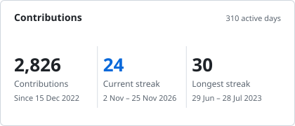
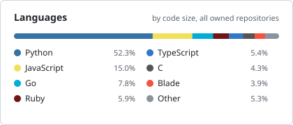

### Raphael Miyoyo

Principal engineer and technical consultant in Nairobi. I design and run the systems behind businesses: backends, integrations and data pipelines, from first architecture to production support, for teams in Europe and East Africa.

**Now**

- **Building [Monica](https://monicahr.com)**, a hiring and careers platform for Kenya: jobs, recruiter-led hiring, and CV tools.
- **Payments and large-scale e-commerce.** Online payment pipelines (M-Pesa, Paystack, Pesapal, KopoKopo), transaction reconciliation, subscriptions and recurring billing, and the order, shop and carrier integrations around them.
- **Management systems.** ERPs, warehouse and fulfilment platforms, CMSs and internal tools that run a business day to day.
- **Bringing AI into businesses.** I help companies put language models to work on their own data and workflows, such as support agents over live operational systems, document automation, and the integrations that keep them dependable in production.
- **Large-scale crawling and data pipelines.** Collecting, cleaning and deduplicating data from many sources, and turning it into something a product can rely on.

**Before**

Eight years across logistics, payments and data, including the multi-carrier shipping and e-commerce integrations of a European fulfilment platform, payment systems processing millions of transactions a year across Kenya, Uganda and Tanzania, and streaming data infrastructure for a public WiFi network with two million users.

Laravel · Python · Django · Go · TypeScript · Vue · PostgreSQL · MySQL · Google Cloud

  <picture>
    <source media="(prefers-color-scheme: dark)" srcset="assets/stats-dark.svg">
    
  </picture>
  <picture>
    <source media="(prefers-color-scheme: dark)" srcset="assets/languages-dark.svg">
    
  </picture>

[LinkedIn](https://www.linkedin.com/in/rmiyoyo) · [raphael@monicahr.com](mailto:raphael@monicahr.com) · [monicahr.com](https://monicahr.com)
